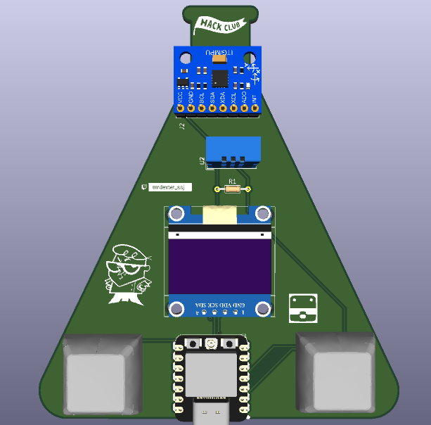

# Dexterbie

Dexterbie is a small tamagotchi-like device! It gives you a friend that sits in your desk during long coding hours. It has 2 buttons, the left one opens the menu and the right one opens the stats menu. It comes with a motion sensor and an environmental sensor, so you can interact physically with your virtual friend!

# What it is

Dexterbie is designed to just sit on your desk and do silly stuff to keep you company. You can interact with it in many ways: by tilting it or through the 2 built-in buttons!

The board includes a microcontroller, display, motion sensor and environmental sensor in a PCB design that looks like a flask. It's USB powered.

This project was created for week one of Hack Club's [Half Life Challenge](https://halflife.hackclub.com/) as an adaptation of [Starbie](https://github.com/SharKingStudios/Starbie), the official starter project.

# Project status

This project includes the 3D Models, Imported Parts.prety and kicad_mod files provided by the example as The Care Package. It also contains the base /Firmware from the tutorial, but with sprite modifications. It also contains JOURNAL.md and BOM.md which are auto-generated by Half Life internal systems. 

Inside /dexterbie you can find the kicad project directory, containing the schematic, PCB layout and other files.

# Note
Some of the products aren't listed in the Parts List of the website, that's because the shipping costs are too high, or because I have easy access to them in physical stores:
* PCB: Shipping costs a lot (approx. $35), so I'll pay for it by myself
* DHT11: I have a physical store where I can buy it
* Resistors: I have a physical store where I can buy them
## Why is there no Tax & Shipping cost listed in the website?
Temu offers free shipping to my address, and taxes aren't significant unless customs requires extra payments

# Links

* Lapse 1: https://lapse.hackclub.com/timelapse/XROP2Fo1KQ4o
* Lapse 2: https://lapse.hackclub.com/timelapse/xe5cPkiZCGmo
* Lapse 3: https://lapse.hackclub.com/timelapse/F-Lf61B5Ms0S
* Lapse 4: Recording as of 11/10/26 21:05 GMT -5
